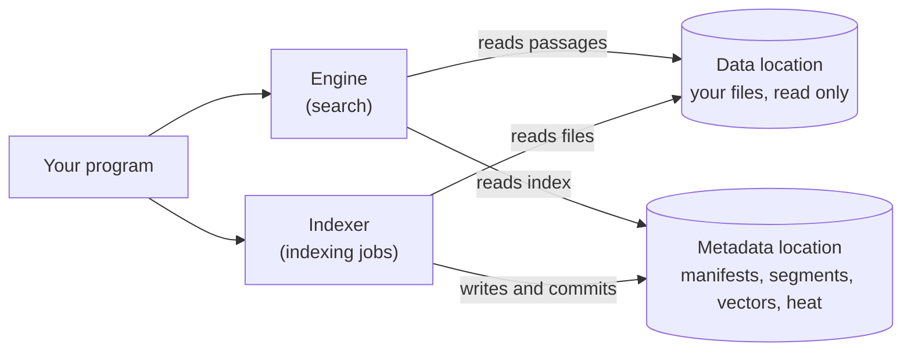
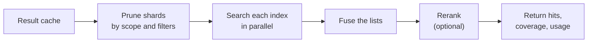

# Architecture

This document explains how cosmosearch stores an index, keeps it consistent, builds it and
searches it. It describes the library as it is today. The API reference on
[docs.rs](https://docs.rs/cosmosearch) has the details of every type.

## The big picture

cosmosearch is a library, not a service. Your program (the *host*) embeds it, and all
durable state lives in two places you choose:

- the **data location**, where your files already are. cosmosearch only ever reads it.
- the **metadata location**, where cosmosearch keeps its index. It belongs to the library.



The engine and the indexer never talk to each other directly. They meet only through the
metadata location, so they can run in different processes or on different machines.

Both locations are prefixes on a storage backend: S3 or an S3-compatible store, a local
folder, or memory (for tests). They can be on different backends or accounts, which lets you
give the data side read-only credentials. The metadata location may also sit inside the data
location; the indexer leaves it out of every listing.

## What is in the metadata location

```text
<metadata location>/
├── INDEX                          the current index id
└── <index id>/
    ├── MANIFEST                   a pointer to a recent manifest (only a hint)
    ├── manifests/v000000000042.json
    ├── segments/<segment id>/     index files, never changed once written
    ├── vectors/<model id>/        embeddings, kept for reuse
    └── heat/                      usage counters
```

**The manifest** is a JSON snapshot of the whole index: its shards, the segments in each
shard, and the size of every segment file. Everything a reader needs to find the index files
is in it, so opening an index costs a couple of small reads.

**Shards** split the data location into ranges of keys, each covering roughly 100 MB to 1 GB
of files. A shard that grows past its limit (1 GiB unless you set another) splits in two.
Shards are the unit of indexing, usage tracking and promotion.

**Segments** are groups of index files inside a shard. They are immutable: new or changed
files produce new segments, and nothing is edited in place. A segment can hold:

| File | Contents |
| --- | --- |
| `meta-<id>.parquet` | The file table: key, size, ETag, status, media type, modified time, attributes |
| `chunks-<id>.parquet` | One record per chunk: where it is in its file, its headings, its hash |
| `lex-<id>.bin` | The BM25 keyword index (tantivy's files bundled into one object) |
| `ivf-<id>.bin` | The vector index: centroids, cluster table, binary and int8 vectors |

Few large files are better than many small ones on object storage, because every object
read costs a round trip. That is why each index kind keeps one file per segment and reads it
by byte range.

## Index levels

Each shard is indexed to a *level*. Deeper levels cost more to build and add more search
capability.

| Level | What it is | When it is built |
| --- | --- | --- |
| L0 | The file table | Always, as soon as a file is known |
| L1 | BM25 keyword index | For every file with text |
| L2 | Vector index (IVF) | For shards that are promoted, by usage or on request |

Keyword search covers everything because it is cheap and needs no model. New files are
always indexed at L1, and vectors are added only by promotion, where they pay off. BM25
lower-cases words and reduces them to their stems, in English unless another of 18
languages is named (`Bm25::stemmed`), or leaves them as they are (`Bm25::plain`). How words
are made is part of the plug-in's kind, so segments built one way are never searched the
other way. Changing it for an existing index is up to you: index the files again, for
example with a retry for each, or their keyword segments are skipped. A shard can also be
demoted, which drops its vector segments and leaves it searchable by keyword.

**Why IVF.** Graph-based vector indexes like HNSW are fast in memory but need many
dependent reads, one per hop, which is slow on object storage. IVF needs two rounds of
parallel reads: compare the query to the cluster centroids, read the binary vectors of the
nearest clusters, then read the int8 vectors of the best candidates and rescore them. Binary
vectors are 32 times smaller than `f32` ones, so scanning them is cheap; int8 restores the
accuracy.

## Committing a change

Every change to the index, from adding one file to replacing a whole shard, becomes visible
in one step: writing the next manifest version.

1. A writer builds whatever new segments it needs. Nobody can see them yet.
2. It writes `manifests/v(N+1).json` with a **create-only write** (`If-None-Match: *`).
   That write is the commit. If two writers race from version N, exactly one succeeds; the
   other gets a conflict, applies its change on top of the new version and tries again.
3. It moves the `MANIFEST` pointer forward.

The pointer is only a hint. Readers start from it and roll forward through any newer
versions, so a pointer that lags behind costs a few extra reads and never gives a wrong
snapshot.

Writes to object storage can time out and still land later. cosmosearch handles this
carefully:

- A timed-out commit is retried with the same body, then read back by its commit id. If the
  outcome is still unclear, the call reports it as *unknown*, which the host treats as
  "still pending" and can safely repeat.
- A manifest version, once used, is never freed. Old manifests are replaced by small stubs,
  never deleted, so a late write can never land in a slot that someone thinks is free.
- Every index has a random id, and all its state lives under that id. If you destroy an
  index and create a new one in the same place, late writes from the old one land under the
  old id and stay invisible.

Because of these rules, any process can crash at any moment. The worst outcome is repeated
work.

**What the store must support.** Create-only writes, reads conditioned on an ETag
(`If-Match`), and strong ETags. cosmosearch probes for create-only writes when it creates an
index, and refuses a store that ignores them. A local folder has no real ETags: the backend
derives one from a file's inode, size and modification time, and checks it before reading
the bytes. A file rewritten in place at the same size and modification time, or rewritten
while it is being read, can go unnoticed, so replace files atomically (write a new file,
then rename it over the old one).

## Index lifecycle

Opening a metadata location reports one of three states:

- **Not indexed:** the location is empty. You can create an index.
- **Ready:** `INDEX` exists and its manifest can be read.
- **Incomplete:** anything in between, such as a crashed create or a partial delete.

Creating an index writes the first manifest, then `INDEX` with a create-only write, so two
racing creates can't both win. Destroying an index removes `INDEX` first, then everything
else. Destroy works from any state, so an incomplete location can always be cleared.

An open engine picks up new commits when you call `refresh()`, or on an interval you set.
Every refresh also re-reads `INDEX`, so an engine notices when its index has been destroyed
or replaced. From then on, every call to that engine fails with the same error, including
searches its result cache could answer; open a new engine to search the new index.

## Getting files into the index

Files reach the index in one of two ways, chosen when the index is created:

- **Listing:** cosmosearch lists the data location (`Indexer::sync_listing`) and records
  every addition, change and removal it finds. Syncs may overlap: each change is checked
  against the file table as it was before the listing, so an older sync never undoes a
  newer one.
- **Host-named:** cosmosearch never lists. You tell it which files exist
  (`Indexer::apply`), which suits buckets where some files must never be read or the
  credentials don't allow listing.

Either way, a change is first committed to the file table, and only then does any work
happen on it. That gives every file a clear status: **pending**, **ready**, **failed** (a
limit was hit, the parser failed, or no part could be read, such as a scanned PDF) or
**unsupported** (no extractor for the type, or no text). You can ask for any file's status
and the reason. A transient read error leaves the file pending rather than failing it.

Files can carry **attributes**: a display name and any values you attach, each a string, a
list of strings, a number or a time. cosmosearch stores them as given, and search can filter
on them. Changing attributes rewrites only the file table, with no re-reading or
re-embedding. Keyword search also matches a file's display name and the last part of its
key, weighted like its text unless `Bm25::name_weight` sets another weight. It matches the
display name the file had when it was last indexed; a retry indexes it again with the new
one. The file table also records each file's media type, when you name one, and its modified
time, from the store or from you.

## Indexing jobs

Indexing is split into small jobs, and the library has no scheduler. You run the jobs
wherever suits you: a background task, a worker queue, a separate process per file.


1. **Plan** finds the pending files and groups them into batches.
2. **Extract** reads one file and cuts its text into chunks, each with a locator.
3. **Build** builds a segment from the chunks of a batch of files.
4. **Publish** commits the segment.

Extraction runs per file, so you can isolate it in its own process and a file that crashes
the process takes down only itself. Its output goes back to you as a plain value; the
library stores no extracted text anywhere. `index::index_pending` runs all four steps in one
process for the common case.

Jobs are safe to repeat and safe to run late. A job's result for a file is applied only if
the file is still pending at the version the job planned for. If the file changed or was
removed in the meantime, that result is dropped, and a segment that would contain it is
rebuilt without it. So a removal always wins over an older job, whatever order things land
in.

**Extraction limits.** Files are untrusted input. You set limits on file size (128 MiB by
default), pages, characters, chunks, archive entries, archive expansion and nesting depth.
A file that hits a limit, or makes a parser panic, fails with a reason. The panic's message
is left out of the reason, but Rust's default panic hook prints it to stderr first, and it
can quote document text; [SECURITY.md](../SECURITY.md) says how to keep it out of your logs. Code in the same
process can't survive running out of memory, so if you index files you don't trust, run the
extract step in a separate process with memory and time limits. The engine extracts files
again to read passages back (for `read`, `expand`, snippets and reranking), so the same
applies to the process that serves searches.

**Chunks** follow the structure of each format: headings and paragraphs for text, Markdown
and HTML, pages for PDF, document elements for docx, records for CSV and values for JSON.
Each chunk's headings are part of its indexed text. Each chunk is hashed with BLAKE3, and
the hash is what lets embeddings be reused.

## Refs

Every result carries a **ref**: the address of its passage in the original file and the
version of the file it came from.

```text
s3://example-bucket/contracts/acme.txt#bytes=18200-19750@etag=9f3a
```

The locator depends on the format: a byte range for text, a page for PDF
(`page=12`), a paragraph for docx (`element=b4/r2/c1/p1`), records for CSV (`rows=7-12`) and
a value for JSON (`value=42`). Refs come only from the file itself, never from internal ids,
so a saved citation stays valid after the index is rebuilt.

`read(ref)` and `expand(ref, before, after)` fetch the passage again from the file, pinned to
the ref's ETag. If the file has changed, the read fails as stale instead of returning
different text.

## Searching



1. **Result cache.** If you set one and an identical search ran against the same manifest
   version, its results come back without any reads. Engines can share one result cache:
   each result is keyed by everything that affects it, including each index plug-in's
   model and search settings (such as how many clusters IVF probes).
2. **Prune.** A scope (a list of key prefixes) drops every shard it doesn't reach before
   anything is read. Filters on attributes (a value, any of several, or a range of
   numbers or times) and on the modified time then decide which files each index may score.
   Pruning uses only the file table.
3. **Search each index.** BM25 and the vector index run at the same time, each over the
   segments that hold allowed files, reading only the parts they need by range request.
   A query made with `with_exact_phrases` asks BM25 to read text in double quotes as a
   phrase: its hits must hold those words next to each other and in order. Word positions
   are read only for such a search. Otherwise quotes are ordinary text, so prose that quotes
   something is searched like any other. BM25 matches a passage holding any word of the
   query, or with `with_every_word`, only one holding all of them. The vector index embeds
   the query as written, so its hits are not held to a phrase or to every word.
4. **Fuse.** The ranked lists are merged with reciprocal rank fusion, which needs no
   comparable scores. A list counts only for the files it covers, so a file without vectors
   isn't penalised for missing from the vector list. You can set the fusion constant and a
   weight per index kind. A search with boosts fuses twice as many candidates and moves up
   those whose file passes a filter, or by how recently it was modified: a candidate stands
   at its rank divided by its boost multiplier. Boosts never add a candidate.
5. **Rerank.** If you set a reranker, it rescores the top 20 fused results (or a shortlist
   size you choose). Boosts then place the reranked hits again by their rerank ranks, so a
   boost counts as much with a reranker as without one. If the reranker fails, the results
   keep their fused order and the response says reranking failed.
6. **Return** the hits, each with its ref, score, boost multiplier, heading path, file
   display name and rank in each list, plus the search's status, coverage and usage. With
   snippets turned on, the best hits also carry their passage text and the positions of the
   query's words in it.

**Status and coverage.** A search ends `found` if it returned results and `inconclusive` if
it didn't. Neither is a claim about whether an answer exists. **Coverage** says what the
search actually looked at: how many files in scope it searched, and how many were pending,
stale, failed, unsupported, or only partly read (such as a PDF with scanned pages), plus any
shards it could not read or did not reach.

**Budgets.** A search can cap the number of shards it opens and the time it takes. The time
includes any refresh the search waits on. Shards it skips are reported, and a search that
runs out of time returns what it has and says so. A search can ask for at most 1,000 hits.

**Missing segments.** If a segment named by the manifest is gone, the engine refreshes and
tries once more. If it is still missing, the shard is reported as unread in the coverage,
and the search goes on without it.

## Embeddings and the vector store

Embeddings are the main running cost, so cosmosearch reuses them wherever it can.

When a shard is promoted, its chunks are hashed and looked up in the vector store by
embedding identity and hash. Only chunks with new hashes are embedded. A renamed, moved or
duplicated file costs nothing, and a changed file costs only its changed chunks. The vector
store is a cache: published segments carry their own vectors, so losing a vector costs at
most embedding it again.

An **embedding identity** covers everything that defines a vector space: model, revision,
dimensions, normalisation, metric and preprocessing. Vectors from different identities are
never mixed.

Embedders and rerankers run locally on the CPU (`embed-local`, `rerank-local`, using
candle; you supply the model files) or call an HTTP API (`embed-http`, `rerank-http`), with
retries and backoff.

## Heat and promotion

*Heat* is a decaying count of how much each shard is used. It drives which shards get
vectors.

- The engine records signals in memory: searches whose scope touched a shard, shards that
  returned hits, `read` and `expand` calls, and shards an inconclusive search left
  unexplored.
- Each process writes its counts to the metadata location under its own writer id, when
  the host calls `flush` (every minute or so). A merge job adds every process's counts
  together without losing or doubling any.
- A **policy** values each shard by its heat against the cost of embedding it, and decides
  to promote or demote, with a gap between the two thresholds so shards don't flap.
- A **spend plan** fills the budget you give it (for example, a number of bytes to embed)
  with the promotions worth the most per unit of cost.

You run flushing, merging, planning and promotion as jobs, like indexing. A host can also
promote a shard directly, or ask for specific files to be embedded right away.

Because a shard is a range of keys, promoting it embeds every file in that range, whether
or not those files are the ones being searched. Heat follows usage only as far as keys do:
put what is used together next to each other, for example a tenant or collection prefix at
the front of each key, rather than opaque ids that scatter related files across shards. A
small index is one shard with the default size, so its first promotion embeds all of it;
set a smaller shard size, or embed chosen files with `plan_embedding`.

## Caching

All caches are optional, bounded, and shared by every engine you hand them to.

- **`Cache`** keeps index files in memory and, optionally, on disk. It cuts them into
  aligned blocks (64 KiB by default), fetches only missing blocks, and fetches a block once
  even when several searches miss it at the same time. Because segment files never change,
  cached blocks stay valid across commits. The disk tier survives a restart.
- **`SearchCache`** keeps whole search results, keyed by the manifest version and everything
  that affects the result. A commit makes older results unreachable.
- **`TextCache`** keeps passage text, keyed by ref, for snippets and reranking.

Results and passages contain document text, so neither is returned after a lifetime you set.
An expired entry leaves memory when it is next looked up or when a later entry is kept. To
bound how long text stays in memory even when a cache sits idle, call `remove_expired` on an
interval.

When you close an index, drop its engines and call `purge` with its id on each cache, to
free its blocks, results and passages.

## Deleting data

Removing a file has three stages:

1. **Logically removed** when the removal is committed to the file table. New searches stop
   returning it.
2. **Gone from readers** when each engine next refreshes.
3. **Physically removed** once the shard is rebuilt without the file and garbage collection
   has deleted the old segments.

Garbage collection is a job you run with two settings: how long superseded manifests are
retained, and a grace period that protects recently written segments whose commit may still
be landing. It replaces expired manifests with stubs, deletes segments no retained manifest
references, sweeps vectors and heat no longer needed, and removes leftovers of destroyed
indexes. So the time until a removed file's bytes are gone is the rebuild delay, plus the
longer of retention and grace, plus the collection interval.

To delete everything, call `destroy` on the metadata location.

## Who does what

| You (the host) | cosmosearch |
| --- | --- |
| Credentials for each location | Every read and write to storage |
| Choosing the data and metadata locations | The layout inside the metadata location |
| Authorization and per-user access | Applying the filters you pass |
| Attributes and display names | Storing them as given |
| Running jobs: where, when, how often | Making jobs safe to repeat |
| Budgets, limits, retention, refresh interval | Enforcing them and reporting usage |
| The async runtime and process isolation | Never creating a runtime or blocking it |

A few things only you can get right:

- Treat an *unknown* commit as still pending, and send the change again.
- Treat extraction output as document text, because it is.
- Keep host-named file lists and attributes somewhere, so you can replay them if the
  metadata location is lost. Everything else can be rebuilt from the data.
- Check access before calling `read` with a ref that came from a user: `read` returns any
  indexed passage its ref names.

## Code layout

| Crate | Role |
| --- | --- |
| `cosmosearch` | The facade: `Engine`, the search types, and one module per area |
| `cosmosearch-core` | Shared types and the plug-in contracts |
| `cosmosearch-store` | Storage backends, the index lifecycle, commits and garbage collection |
| `cosmosearch-format` | The file table and chunk records, in Parquet |
| `cosmosearch-chunk` | Running extractors safely and cutting passages into chunks |
| `cosmosearch-indexer` | File changes, indexing jobs, promotion |
| `cosmosearch-query` | The reader: search, read, expand, refresh |
| `cosmosearch-lexical` | BM25 over tantivy |
| `cosmosearch-vector` | The vector store, k-means, the IVF index and their file formats |
| `cosmosearch-extract-*` | Extractors for CSV, docx, HTML, JSON and PDF |
| `cosmosearch-embed-local`, `-rerank-local` | Local models over candle |
| `cosmosearch-http` | Embedder and reranker over HTTP |
| `cosmosearch-cache` | The block, result and passage caches |
| `cosmosearch-heat` | Heat counters, merging and the promotion policy |

The kernel (`query`, `indexer` and what they use) depends on no plug-in. Plug-ins depend on
`core`, plus `format` and `store` when they need them, and never on each other. The
facade's features turn plug-ins on, and a check in CI makes sure the minimal build pulls in
none of them.
